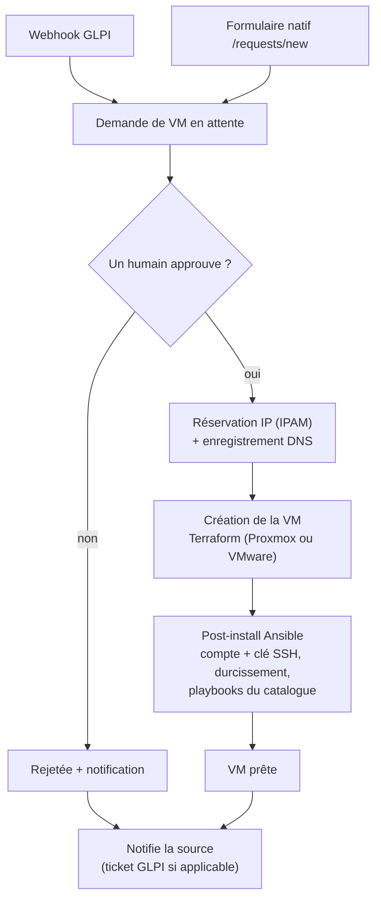

# 🔨 Hephaestus

Hephaestus automatise la création de VM de bout en bout, sans étape manuelle : une
demande (ticket GLPI ou formulaire web) est validée par un humain, puis l'app réserve
une IP, crée la VM sur Proxmox ou VMware, et configure le système dessus (Ansible), tout seule.



Schéma plus détaillé (étape par étape, qui utilise quel compte à chaque phase) :
[voir ici](https://claude.ai/artifact/DHzkuGaJLP8cfgoxNAJUXU).

**Scope actuel** : Proxmox et VMware/vCenter fonctionnent tous les deux, testés de bout
en bout sur une vraie infrastructure, et peuvent être actifs en même temps, chaque
demande choisit sa cible dans le formulaire. Post-install Linux uniquement (Windows
reste un brouillon jamais testé).

**Licence** : voir [`LICENSE`](LICENSE), publié pour évaluation/test, pas une licence
open-source permissive.

## ⚙️ Fonctionnalités disponibles

- **Deux points d'entrée équivalents** : webhook GLPI (`/webhooks/glpi`) et formulaire
  natif (`/requests/new`) créent exactement le même objet interne et suivent le même
  circuit, aucun traitement spécial pour l'un ou l'autre. Le formulaire natif peut être
  désactivé depuis `/settings` si tu passes uniquement par GLPI.
- **Validation humaine obligatoire** sur un dashboard web, jamais d'approbation
  automatique.


- **Après approbation** : réservation IP, enregistrement DNS (si configuré), création
  de la VM (Proxmox ou VMware selon le choix fait dans la demande), puis post-install
  Ansible (compte dédié + clé SSH, fermeture de l'accès root, mise à jour système,
  playbooks de ton choix). Chaque étape affiche son propre statut (vert/rouge) sur la
  page de la demande.
- **Catalogue de playbooks** géré depuis l'interface, déploiement à la demande contre
  n'importe quel hôte de ton inventaire (pas seulement les VMs créées par ce pipeline),
  sortie en direct.
  
- **Identifiants Ansible multiples** : un compte + une clé SSH différente par groupe
  d'inventaire si besoin, pas un seul compte imposé à tout le parc.
- **Groupes de permissions personnalisables** (`/settings/groups`), pas de rôle figé
  admin/viewer, chaque groupe combine librement les droits voulus.
- **Vérificateur de mise à jour** intégré (`/settings`) et images Docker versionnées
  (voir Quickstart).

### Connecteurs

| Catégorie | Provider | État |
|---|---|---|
| Hyperviseur | Proxmox VE | réel, testé |
| Hyperviseur | VMware vCenter | réel, testé |
| IPAM | phpIPAM | réel, testé |
| IPAM | EfficientIP, Microsoft IPAM | stub (pas de vrai appel API) |
| DNS | Technitium | réel, testé |
| DNS | Windows DNS | code écrit, jamais testé contre un vrai serveur |
| DNS | BIND | stub |
| ITSM | GLPI (API v2 OAuth2) | réel, testé |
| SCM | Gitea (dépôt de playbooks) | réel, testé |
| Annuaire | LDAP/LDAPS, Keycloak (OIDC) | réel |

Connexions configurables depuis l'interface web ou en CLI, test de connexion intégré,
secrets chiffrés au repos.


## 📋 Champs d'une demande de VM

Que la demande arrive par le formulaire natif ou par GLPI, l'app attend les mêmes
informations de base :

| Champ | Requis | Signification |
|---|---|---|
| `hostname` | oui | Nom de la VM à créer |
| `hypervisor_connection` | non | Quelle connexion hyperviseur cibler (Proxmox ou VMware), disponible uniquement via `/requests/new` pour l'instant, pas encore côté GLPI |
| `os_template` | non | Quel template cloner, résolu en direct contre l'hyperviseur (pas une liste codée en dur) |
| `cpu` | non | Nombre de vCPU |
| `ram_gb` | non | RAM en Go |
| `disk_gb` | non | Disque en Go |
| `vlan` | non | VLAN cible, normalisé automatiquement à son seul numéro ("VLAN 100" → "100") |
| `environment` | non | Libre (ex: "production"), disponible uniquement via `/requests/new` |

**Format attendu côté GLPI** : le contenu du ticket (`item.content`) doit contenir des
lignes au format `<b>N) Label</b>: valeur<br>` (ce que produit un formulaire GLPI
Formcreator), avec ces labels précis (`backend/app/parsers/glpi_formcreator.py`) :
`Nom de la VM`, `Template à cloner`, `vCPU`, `RAM`, `VLAN`, `Taille disque`, tous
obligatoires côté GLPI, contrairement au formulaire natif où seul `hostname` l'est.

## ✅ Prérequis

- Docker + Docker Compose
- **Au moins un hyperviseur** : Proxmox (token API) ou vCenter VMware (compte de
  service, voir "Hyperviseurs" plus bas pour les permissions exactes), ou les deux
- Un serveur phpIPAM
- Un dépôt Git accessible en SSH pour tes playbooks Ansible (pas fourni, voir plus bas)
- (Optionnel) Technitium DNS pour l'enregistrement automatique de chaque VM
- (Optionnel) Une instance GLPI avec l'API v2 (OAuth2) activée

## 🖥️ Hyperviseurs

Proxmox et VMware peuvent être actifs en même temps, chaque demande de VM choisit
explicitement sa cible dans le formulaire.

**Template VMware : prérequis précis** (sinon le bootstrap cloud-init échoue en
silence) :
- `cloud-init` et `open-vm-tools` installés
- `PermitRootLogin yes` dans `/etc/ssh/sshd_config` (Debian le restreint par défaut)
- `cloud-init clean --logs` avant de convertir en template
- Garder le template à jour (`apt upgrade`) de temps en temps, un template resté
  stable trop longtemps augmente le risque que le post-install tombe en plein milieu
  de la mise à jour automatique que Debian lance lui-même au premier démarrage

**Compte de service VMware : permissions minimales**, à assigner sur l'objet précis
(hôte/cluster/dossier dédié, avec "Propagate to children") :
- Virtual Machine → Inventaire : Créer, Créer à partir d'un modèle existant, Supprimer,
  Déplacer
- Virtual Machine → Modifier la configuration : Ajouter disque, Ajouter/supprimer
  périphérique, Configuration avancée, **Changer ressource**, Changer CPU/mémoire,
  Modifier les paramètres, Renommer
- Virtual Machine → Approvisionnement : Cloner, Déployer un modèle
- Virtual Machine → Interaction : Allumer, Éteindre, Réinitialiser
- Resource → Assigner au pool de ressources, **Migration à froid**, **Migration à chaud**
- Datastore → Allouer de l'espace, Parcourir, Gestion de fichiers
- Network → Assign
- Folder → Create (si les VM sont rangées dans un dossier)

Les deux en gras sont celles qui manquent le plus souvent dans un premier essai, le
détail de la permission exacte manquante se trouve dans le **journal d'événements
vCenter**, pas l'historique des tâches.

## 🚀 Démarrage rapide

Deux façons de démarrer, choisis selon ton besoin.

### Commun aux deux options

```bash
cp .env.example .env
```
Édite `.env` : mot de passe Postgres, et génère un `SESSION_SECRET` + un
`ANSIBLE_ADMIN_PASSWORD` avec :
```bash
python3 -c "import secrets; print(secrets.token_hex(32))"
```

Deux clés SSH dédiées, jamais la même (une pour déployer sur tes VMs, une pour
récupérer tes playbooks en lecture seule) :
```bash
mkdir -p .secrets
ssh-keygen -t ed25519 -f .secrets/vmprov_bastion_key -N "" -C "vmprov-automation"
ssh-keygen -t ed25519 -f .secrets/vmprov_gitea_key -N "" -C "vmprov-playbooks-fetch"
```
La clé publique de `vmprov_gitea_key` doit être ajoutée comme **deploy key en lecture
seule** sur ton dépôt de playbooks.

Ce dépôt n'inclut pas de playbooks Ansible prêts à l'emploi (chacun a sa propre infra).
Crée un dépôt Git séparé avec au minimum `requirements.yml`, un playbook qui crée un
compte + déploie une clé SSH, et un playbook qui ferme l'accès root.

### Option A : cloner et construire soi-même

```bash
docker compose up -d --build
```
Construit l'image localement (quelques minutes la première fois). À utiliser si tu
comptes modifier le code toi-même.

### Option B : image pré-construite (plus rapide)

```bash
docker compose -f docker-compose.yml -f docker-compose.prebuilt.yml pull
docker compose -f docker-compose.yml -f docker-compose.prebuilt.yml up -d
```
Télécharge l'image déjà construite (`ghcr.io/mshadow6/hephaestus`) au lieu de
compiler, quelques secondes au lieu de quelques minutes. Pour rester sur une version
précise plutôt que la dernière, remplace `:latest` par `:v1.2.0` (ou la version voulue)
dans `docker-compose.prebuilt.yml`.

### Ensuite, dans les deux cas

Première ouverture sur `http://localhost` : un compte admin est à créer au premier
lancement. Puis depuis `/connections` (ou en CLI, `python -m app.cli connection
--help`) : configure ta connexion hyperviseur, ta connexion phpIPAM, ton dépôt de
playbooks, et GLPI si tu l'utilises. Chaque formulaire a un bouton "Tester la
connexion".

## 🧱 Architecture

```
backend/   FastAPI (dashboard + API), SQLAlchemy/Alembic, RQ (jobs async)
terraform/ Un module par hyperviseur : proxmox/ (bpg/proxmox), vsphere/ (vmware/vsphere)
config/    Catalogue de playbooks, connexions (secrets chiffrés, jamais commités, .gitignore)
```

## ⚠️ Limites connues

- **Formulaire GLPI** : pas encore de choix d'hyperviseur (seul le formulaire natif
  l'a), à faire côté configuration du formulaire GLPI, pas du code de l'app.
- **Post-install Windows** et **`WindowsDnsProvider`** : code écrit, jamais testé
  contre une vraie infra Windows.
- **EfficientIP, Microsoft IPAM, BIND** : stubs, aucun vrai appel API pour l'instant.
- **Agrandissement de disque générique** (LVM/partition) non testé contre un hôte réel.
- **Catalogue de playbooks** : seuls le durcissement SSH et la mise à jour système sont
  de vrais playbooks testés, les autres entrées sont volontairement vides.
- **Pipeline non idempotent** : relancer une demande déjà passée par le durcissement
  SSH échoue toujours (root est fermé pour de bon à ce stade).
- **Mot de passe sudo partagé entre toutes les VM** (`ANSIBLE_ADMIN_PASSWORD`), un mot
  de passe unique par VM dans un vrai coffre-fort est prévu, pas commencé.
