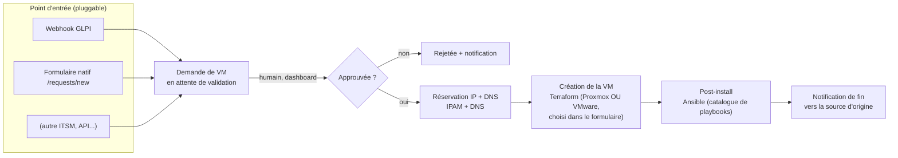

# 🔨 Hephaestus

Provisioning de VM self-hosted, sans étape manuelle : une demande de VM → validation
humaine sur un dashboard web → réservation IP (IPAM) → création de la VM (Terraform) →
post-install (Ansible) → notification à la source de la demande.



**Scope actuel** : Proxmox **et** VMware/vCenter fonctionnent tous les deux, testés de
bout en bout sur une vraie infrastructure, et peuvent être actifs **en même temps**,
chaque demande de VM choisit explicitement sa cible dans le formulaire (voir
"Hyperviseurs" plus bas). Post-install Windows (WinRM) reste un brouillon jamais testé
(pas d'infra Windows disponible au moment de l'écrire) ; Linux uniquement pour le
post-install à ce stade.
💡 En bref
Délivrance zéro étape manuelle : Validation en un clic sur le tableau de bord, le pipeline s'occupe du reste.
Architecture Pluggable : Interfaces modulaires pour les fournisseurs IPAM, DNS, Hyperviseurs et sources de demandes.
Multi-Hyperviseur simultané : Gestion parallèle de clusters Proxmox VE et VMware vCenter .
Post-configuration automatisée : Exécution de playbooks Ansible sur mesure (durcissement SSH, mise à jour, agents).
Suivi en temps réel : Visibilité détaillée étape par étape (IPAM, DNS, Terraform, Ansible) au lieu d'un statut global ambigu.
⚙️ Fonctionnalités clés
Multi-sources de demande : Formulaire natif dynamique (filtrage des templates réels par hyperviseur, vérification du nom d'hôte) ou webhook GLPI.

Orchestration modulaire :

IPAM & DNS : phpIPAM et Technitium DNS pré-intégrés.

Provisionnement : Modules Terraform dédiés pour Proxmox et vSphere.

Post-install Linux : Déploiement de clés SSH, suppression de l'accès root, mises à jour et playbooks personnalisés.

Catalogue de playbooks : Gestion dynamique de playbooks Ansible obligatoires ou optionnels depuis l'interface web.

Sécurité et granularité :

Secrets chiffrés au repos.

Modèle de permissions RBAC sur-mesure ( /settings/groups).

Connexions testables en un clic via l'IHM ou la CLI.

## 🚀 Quickstart

### 1. Configuration de base

```bash
cp .env.example .env
```

Édite `.env` : mets un vrai mot de passe Postgres, génère un `SESSION_SECRET` et un
`ANSIBLE_ADMIN_PASSWORD` avec :

```bash
python3 -c "import secrets; print(secrets.token_hex(32))"
```

### 2. Clés SSH

Deux clés dédiées, jamais la même, une pour déployer sur tes VMs, une pour récupérer tes
playbooks (lecture seule) :

```bash
mkdir -p .secrets
ssh-keygen -t ed25519 -f .secrets/vmprov_bastion_key -N "" -C "vmprov-automation"
ssh-keygen -t ed25519 -f .secrets/vmprov_gitea_key -N "" -C "vmprov-playbooks-fetch"
```

La clé publique de `vmprov_gitea_key` doit être ajoutée comme **deploy key en lecture
seule** sur ton dépôt de playbooks (GitHub : Settings → Deploy keys ; Gitea : Settings →
Deploy Keys).

### 3. Dépôt de playbooks

Ce dépôt n'inclut pas de playbooks Ansible tout prêts à exécuter en prod, chacun a sa
propre infra, ses propres outils (EDR, supervision...), donc ses propres playbooks. Crée
un dépôt Git séparé avec au minimum :

- `requirements.yml` (collections Ansible nécessaires)
- un playbook qui crée un compte admin + déploie une clé SSH sur une VM fraîche
- un playbook qui ferme l'accès root en SSH

Le catalogue de l'application (`/playbooks`) pointe vers des chemins dans ce dépôt,
chaque entrée est éditable depuis l'interface (chemin, catégorie obligatoire/optionnel,
description). Un playbook du catalogue dont le fichier n'existe pas encore dans ton dépôt
est simplement ignoré (log, pas d'erreur bloquante), tu peux déclarer ton catalogue avant
d'avoir écrit le contenu.

### 4. Démarrage

```bash
docker compose up -d --build
```

Première ouverture sur `http://localhost` (port 80, via Caddy, le backend n'est plus
exposé directement sur `8000`) : un compte admin est à créer au premier lancement.

### 5. Connexions

Depuis `/connections` (ou en CLI, `python -m app.cli connection --help`) : configure ta
connexion Proxmox (URL API + token), ta connexion phpIPAM, ton dépôt de playbooks (URL
SSH), et GLPI si tu l'utilises. Chaque formulaire a un bouton "Tester la connexion" qui
affiche l'erreur précise en cas de souci.

## 🧱 Architecture

```
backend/   FastAPI (dashboard + API), SQLAlchemy/Alembic, RQ (jobs async)
terraform/ Un module par hyperviseur : proxmox/ (bpg/proxmox), vsphere/ (vmware/vsphere)
config/    Catalogue de playbooks, connexions (secrets chiffrés, jamais commités, .gitignore)
```

Le détail des décisions techniques prises au fil du développement est dans
[`JOURNAL.md`](JOURNAL.md), utile pour comprendre le "pourquoi" d'un choix, pas un guide
d'installation.

## ⚠️ Limites connues

- **Formulaire GLPI** : pas encore mis à jour pour proposer le choix d'hyperviseur
  (seul le formulaire natif l'a), à faire du côté de la configuration du formulaire
  GLPI lui-même, pas du code de l'app.
- **Post-install Windows** (WinRM, vérification d'agent) : brouillon, jamais testé,
  pas d'infra Windows disponible pour le valider au moment de l'écrire.
- **`WindowsDnsProvider`** : code réel écrit (WinRM + PowerShell), jamais testé contre un
  vrai serveur DNS Windows, même raison.
- L'abstraction IPAM supporte plusieurs backends dans l'interface, seul phpIPAM est
  implémenté pour de vrai aujourd'hui (EfficientIP reste un stub).
- L'agrandissement de disque générique (LVM/partition) n'a pas été testé contre un hôte
  réel, vérifie sur une VM jetable avant tout usage en production.
- **Catalogue de playbooks** : seuls le durcissement SSH (compte admin + fermeture root)
  et la mise à jour système (`update-os.yml`) sont de vrais playbooks testés. Les autres
  entrées du catalogue (EDR, supervision, agrandissement de disque...) sont volontairement
  vides, dépendent de l'outillage propre à chaque infra, à écrire au cas par cas.
- **Pipeline non idempotent** : relancer une demande déjà passée par le durcissement SSH
  échoue toujours (root est fermé pour de bon à ce stade), pas de détection de l'état
  réel de la VM avant de rejouer tout le pipeline depuis le début.
- **Mot de passe sudo partagé entre toutes les VM** (`ANSIBLE_ADMIN_PASSWORD`, `.env`),
  un vrai manque de cloisonnement (compromettre une VM donne ce mot de passe pour toutes
  les autres). Objectif identifié : générer un mot de passe unique par VM à la création
  et le stocker dans un vrai coffre-fort (Passbolt envisagé, pas Vaultwarden, API REST
  plus adaptée à un usage piloté par un script qu'une interface pensée pour l'humain),
  pas commencé, chantier à part entière.
