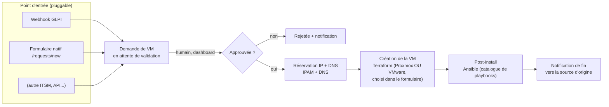

# 🔨 Hephaestus

Provisioning de VM self-hosted, sans étape manuelle : une demande de VM → validation
humaine sur un dashboard web → réservation IP (IPAM) → création de la VM (Terraform) →
post-install (Ansible) → notification à la source de la demande.



**Scope actuel** : Proxmox **et** VMware/vCenter fonctionnent tous les deux, testés de
bout en bout sur une vraie infrastructure, et peuvent être actifs **en même temps**,
chaque demande de VM choisit explicitement sa cible dans le formulaire (voir
"Hyperviseurs" plus bas). Post-install Windows (WinRM) reste un brouillon jamais testé
(pas d'infra Windows disponible au moment de l'écrire) ; Linux uniquement pour le
post-install à ce stade.

**Important sur le vocabulaire** : "GLPI" est le **premier** provider implémenté pour le
point d'entrée des demandes, pas une limite définitive. L'IPAM, le DNS et l'hyperviseur
sont tous les trois construits comme de vraies interfaces pluggables (`backend/app/ipam/`,
`backend/app/dns/`, `backend/app/provisioning/terraform_runner.py`, un module Terraform
par hyperviseur, choisi dynamiquement). Le point d'entrée des demandes suit le même
principe : le webhook GLPI et le formulaire natif (`/requests/new`) créent tous les deux
exactement le même objet interne et suivent ensuite le même pipeline, sans distinction de
traitement derrière.

**Licence** : voir [`LICENSE`](LICENSE), publié pour évaluation/test, pas une licence
open-source permissive (voir ce fichier pour le détail).

**Sécurité** : revue régulièrement (durcissement réseau, secrets chiffrés au repos,
authentification anti-bruteforce...), documentation détaillée gardée en interne plutôt
que publiée ici.

## ⚙️ Ce que fait l'application

- Reçoit une demande de VM, webhook GLPI (`/webhooks/glpi`) **ou** formulaire natif du
  dashboard (`/requests/new`), les deux créent la même chose et suivent le même circuit.
  Le formulaire natif propose une liste déroulante des templates réellement présents sur
  l'hyperviseur **choisi** (Proxmox et VMware peuvent être actifs en même temps, la
  liste de templates se filtre selon l'hyperviseur sélectionné), rejette un nom d'hôte
  déjà utilisé par une demande active, et peut être désactivé entièrement depuis
  `/settings` si tu passes uniquement par GLPI (le webhook, lui, reste actif quoi qu'il arrive)
- La met en attente de validation par un humain sur un dashboard web, jamais approuvée
  automatiquement par le code, toujours une décision humaine explicite


- Une fois approuvée : réserve une IP (phpIPAM par défaut, interface branchée pour
  d'autres providers IPAM), crée l'enregistrement DNS correspondant si un connecteur DNS
  est actif (Technitium aujourd'hui, un vrai provider testé, Windows DNS a du code
  écrit mais jamais testé contre un vrai serveur), crée la VM via Terraform (Proxmox
  **ou** VMware selon le choix fait dans la demande), puis exécute un post-install
  Ansible (compte admin + clé SSH, fermeture de l'accès root en SSH, mise à jour système,
  et les playbooks de ton choix), chaque étape affiche son propre statut vert/réussi ou
  rouge/échec sur la page de la demande, pas juste un statut global ambigu
- Notifie le ticket GLPI d'origine à chaque étape (approbation, rejet, fin de création),
  silencieusement ignoré si la demande ne vient pas de GLPI
- Catalogue de playbooks gérable depuis l'interface (obligatoire/optionnel configurable
  par toi, pas figé dans le code), déploiement à la demande contre n'importe quel hôte de
  ton inventaire (pas seulement les VMs créées par ce pipeline), sortie en direct
  
- Connexions (Proxmox, VMware, phpIPAM, DNS, GLPI, dépôt Git de playbooks, LDAP,
  Keycloak) configurables depuis l'interface web ou en CLI, avec test de connexion
  intégré, secrets chiffrés au repos (jamais stockés en clair sur disque)
  
- Groupes de permissions personnalisables (`/settings/groups`), pas de rôle figé
  admin/viewer, chaque groupe combine librement les droits qu'on veut lui donner (créer
  des VM, gérer les connecteurs, lancer des playbooks, gérer les utilisateurs...)


## 📋 Champs d'une demande de VM

Que la demande arrive par le formulaire natif ou par GLPI, l'app attend les mêmes
informations de base :

| Champ | Requis | Signification |
|---|---|---|
| `hostname` | oui | Nom de la VM à créer |
| `hypervisor_connection` | non | Quelle connexion hyperviseur cibler (Proxmox ou VMware), disponible uniquement via `/requests/new` pour l'instant, pas encore côté GLPI. Si absent et plusieurs hyperviseurs sont actifs, le choix retombe sur le premier trouvé, pas garanti, précise-le explicitement. |
| `os_template` | non | Quel template cloner, voir **limite importante** ci-dessous |
| `cpu` | non | Nombre de vCPU |
| `ram_gb` | non | RAM en Go |
| `disk_gb` | non | Disque en Go |
| `vlan` | non | VLAN cible, normalisé automatiquement à son seul numéro ("VLAN 100" → "100"), utilisé pour choisir le bon sous-réseau si l'IPAM en gère plusieurs (voir `/connections/<nom>/subnets`) |
| `environment` | non | Libre (ex: "production"), disponible uniquement via `/requests/new`, pas transmis par le formulaire GLPI actuel |

**Sur `os_template`** : résolu en direct contre le cluster Proxmox (nom de VM marquée
"template" dans Proxmox), pas une liste codée en dur à maintenir. Le formulaire natif
affiche les templates réellement trouvés ; via GLPI, la valeur envoyée doit correspondre
exactement au nom du template dans Proxmox, sinon la création échoue avec "Template
Proxmox introuvable".

**Format attendu côté GLPI** (si tu utilises le webhook plutôt que le formulaire natif) :
le contenu du ticket (`item.content`) doit contenir des lignes au format
`<b>N) Label</b>: valeur<br>` (ce que produit nativement un formulaire GLPI Formcreator),
avec ces labels précis (`backend/app/parsers/glpi_formcreator.py`) :
`Nom de la VM`, `Template à cloner`, `vCPU`, `RAM`, `VLAN`, `Taille disque`, tous
obligatoires côté GLPI (contrairement au formulaire natif, où seul `hostname` l'est).
L'ordre n'a pas d'importance, le matching se fait sur le label.

## ✅ Prérequis

- Docker + Docker Compose
- **Au moins un hyperviseur** : un cluster/nœud Proxmox (avec un token API), **ou** un
  vCenter VMware (avec un compte de service, voir "Hyperviseurs" plus bas pour les
  permissions exactes), **ou les deux à la fois**
- Un serveur phpIPAM (ou un autre IPAM, voir `backend/app/ipam/`, interface à
  implémenter pour brancher autre chose)
- Un dépôt Git accessible en SSH pour y stocker tes playbooks Ansible (le dépôt
  lui-même n'est pas fourni, voir plus bas)
- (Optionnel) Un serveur DNS pour l'enregistrement automatique de chaque VM, Technitium
  DNS Server est le provider réellement implémenté et testé (`backend/app/dns/`, Windows
  DNS a du code écrit mais non testé)
- (Optionnel) Une instance GLPI avec l'API v2 (OAuth2) activée, si tu veux le flux
  ticket → VM plutôt qu'un appel API direct

## 🖥️ Hyperviseurs

Proxmox et VMware peuvent être actifs **en même temps**, chaque demande de VM choisit
explicitement sa cible dans le formulaire (menu déroulant "Hyperviseur"), et la liste des
templates proposée se filtre automatiquement selon le choix. Rien n'empêche de n'activer
qu'un seul des deux si c'est tout ce dont tu as besoin.

**Template VMware : prérequis précis** (sinon le bootstrap cloud-init échoue en silence,
vécu en le construisant) :
- `cloud-init` **et** `open-vm-tools` installés (c'est ce dernier qui expose les infos au
  template via le canal "GuestInfo" que cloud-init lit)
- `PermitRootLogin yes` dans `/etc/ssh/sshd_config` (Debian le restreint par défaut,
  même limite que sur le template Proxmox)
- `cloud-init clean --logs` **avant** de convertir en template (sinon cloud-init pense
  avoir déjà fait son premier démarrage et ne rejoue plus rien sur les clones)
- Garder le template à jour (`apt upgrade`) de temps en temps, un template resté stable
  trop longtemps augmente le risque que le post-install (`apt update` dans
  `update-os.yml`) tombe en plein milieu de la mise à jour automatique que Debian lance
  lui-même au premier démarrage (verrou `dpkg` partagé, pas un bug du pipeline).

**Compte de service VMware : permissions minimales exactes**, à assigner sur l'objet
précis (hôte/cluster/dossier dédié, avec "Propagate to children"), pas au niveau racine
du vCenter :
- Virtual Machine → Inventaire : Créer, Créer à partir d'un modèle existant, Supprimer,
  Déplacer
- Virtual Machine → Modifier la configuration : Ajouter disque, Ajouter/supprimer
  périphérique, Configuration avancée, **Changer ressource**, Changer CPU/mémoire,
  Modifier les paramètres, Renommer
- Virtual Machine → Approvisionnement : Cloner, Déployer un modèle
- Virtual Machine → Interaction : Allumer, Éteindre, Réinitialiser
- Resource → Assigner au pool de ressources, **Migration à froid**, **Migration à chaud**
  (nécessaire dès qu'on fixe explicitement l'hôte ET le pool de ressources cible)
- Datastore → Allouer de l'espace, Parcourir, Gestion de fichiers
- Network → Assign
- Folder → Create (si les VM sont rangées dans un dossier)

Les deux en gras (**Changer ressource**, **Migration à froid/à chaud**) sont celles qui
manquent le plus souvent dans un premier essai, l'erreur `Permission to perform this
operation was denied` sans précision suffisante côté Terraform, le vrai détail (quelle
permission exacte) se trouve dans le **journal d'événements vCenter**, pas l'historique
des tâches.

## 🚀 Quickstart

### 1. Configuration de base

```bash
cp .env.example .env
```

Édite `.env` : mets un vrai mot de passe Postgres, génère un `SESSION_SECRET` et un
`ANSIBLE_ADMIN_PASSWORD` avec :

```bash
python3 -c "import secrets; print(secrets.token_hex(32))"
```

### 2. Clés SSH

Deux clés dédiées, jamais la même, une pour déployer sur tes VMs, une pour récupérer tes
playbooks (lecture seule) :

```bash
mkdir -p .secrets
ssh-keygen -t ed25519 -f .secrets/vmprov_bastion_key -N "" -C "vmprov-automation"
ssh-keygen -t ed25519 -f .secrets/vmprov_gitea_key -N "" -C "vmprov-playbooks-fetch"
```

La clé publique de `vmprov_gitea_key` doit être ajoutée comme **deploy key en lecture
seule** sur ton dépôt de playbooks (GitHub : Settings → Deploy keys ; Gitea : Settings →
Deploy Keys).

### 3. Dépôt de playbooks

Ce dépôt n'inclut pas de playbooks Ansible tout prêts à exécuter en prod, chacun a sa
propre infra, ses propres outils (EDR, supervision...), donc ses propres playbooks. Crée
un dépôt Git séparé avec au minimum :

- `requirements.yml` (collections Ansible nécessaires)
- un playbook qui crée un compte admin + déploie une clé SSH sur une VM fraîche
- un playbook qui ferme l'accès root en SSH

Le catalogue de l'application (`/playbooks`) pointe vers des chemins dans ce dépôt,
chaque entrée est éditable depuis l'interface (chemin, catégorie obligatoire/optionnel,
description). Un playbook du catalogue dont le fichier n'existe pas encore dans ton dépôt
est simplement ignoré (log, pas d'erreur bloquante), tu peux déclarer ton catalogue avant
d'avoir écrit le contenu.

### 4. Démarrage

```bash
docker compose up -d --build
```

Première ouverture sur `http://localhost` (port 80, via Caddy, le backend n'est plus
exposé directement sur `8000`) : un compte admin est à créer au premier lancement.

### 5. Connexions

Depuis `/connections` (ou en CLI, `python -m app.cli connection --help`) : configure ta
connexion Proxmox (URL API + token), ta connexion phpIPAM, ton dépôt de playbooks (URL
SSH), et GLPI si tu l'utilises. Chaque formulaire a un bouton "Tester la connexion" qui
affiche l'erreur précise en cas de souci.

## 🧱 Architecture

```
backend/   FastAPI (dashboard + API), SQLAlchemy/Alembic, RQ (jobs async)
terraform/ Un module par hyperviseur : proxmox/ (bpg/proxmox), vsphere/ (vmware/vsphere)
config/    Catalogue de playbooks, connexions (secrets chiffrés, jamais commités, .gitignore)
```

Le détail des décisions techniques prises au fil du développement est dans
[`JOURNAL.md`](JOURNAL.md), utile pour comprendre le "pourquoi" d'un choix, pas un guide
d'installation.

## ⚠️ Limites connues

- **Formulaire GLPI** : pas encore mis à jour pour proposer le choix d'hyperviseur
  (seul le formulaire natif l'a), à faire du côté de la configuration du formulaire
  GLPI lui-même, pas du code de l'app.
- **Post-install Windows** (WinRM, vérification d'agent) : brouillon, jamais testé,
  pas d'infra Windows disponible pour le valider au moment de l'écrire.
- **`WindowsDnsProvider`** : code réel écrit (WinRM + PowerShell), jamais testé contre un
  vrai serveur DNS Windows, même raison.
- L'abstraction IPAM supporte plusieurs backends dans l'interface, seul phpIPAM est
  implémenté pour de vrai aujourd'hui (EfficientIP reste un stub).
- L'agrandissement de disque générique (LVM/partition) n'a pas été testé contre un hôte
  réel, vérifie sur une VM jetable avant tout usage en production.
- **Catalogue de playbooks** : seuls le durcissement SSH (compte admin + fermeture root)
  et la mise à jour système (`update-os.yml`) sont de vrais playbooks testés. Les autres
  entrées du catalogue (EDR, supervision, agrandissement de disque...) sont volontairement
  vides, dépendent de l'outillage propre à chaque infra, à écrire au cas par cas.
- **Pipeline non idempotent** : relancer une demande déjà passée par le durcissement SSH
  échoue toujours (root est fermé pour de bon à ce stade), pas de détection de l'état
  réel de la VM avant de rejouer tout le pipeline depuis le début.
- **Mot de passe sudo partagé entre toutes les VM** (`ANSIBLE_ADMIN_PASSWORD`, `.env`),
  un vrai manque de cloisonnement (compromettre une VM donne ce mot de passe pour toutes
  les autres). Objectif identifié : générer un mot de passe unique par VM à la création
  et le stocker dans un vrai coffre-fort (Passbolt envisagé, pas Vaultwarden, API REST
  plus adaptée à un usage piloté par un script qu'une interface pensée pour l'humain),
  pas commencé, chantier à part entière.
